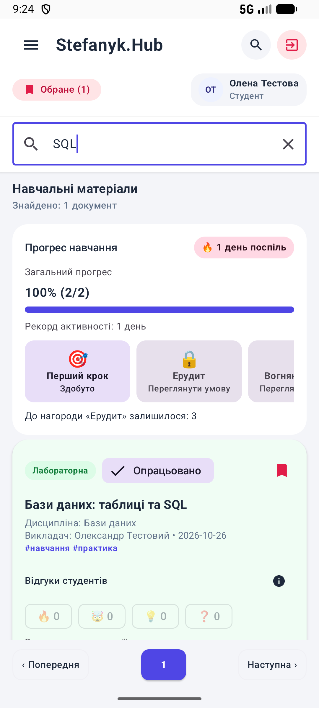
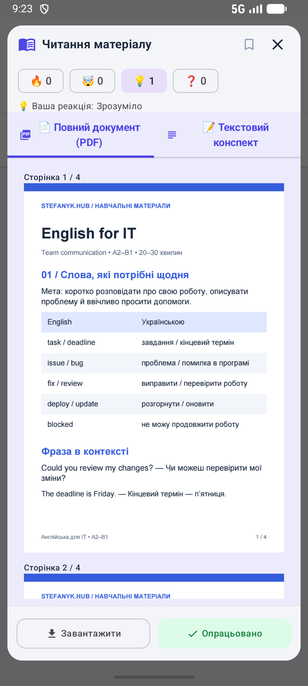
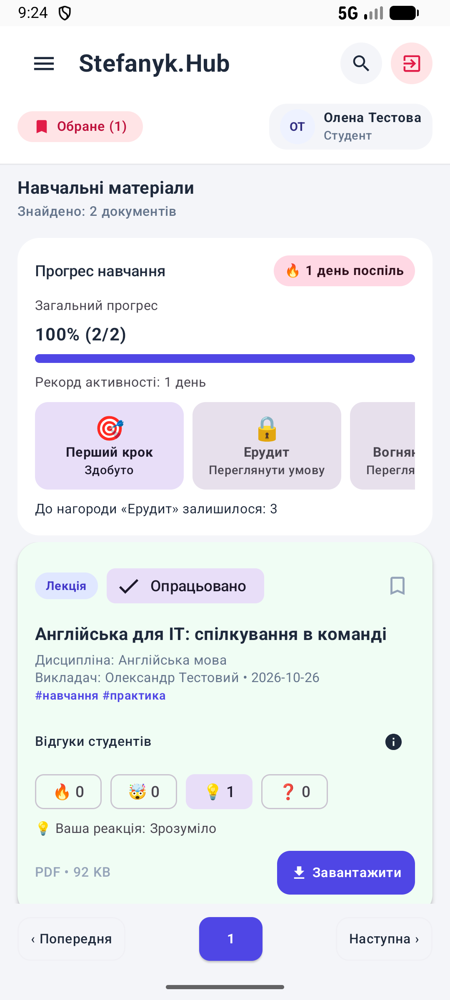
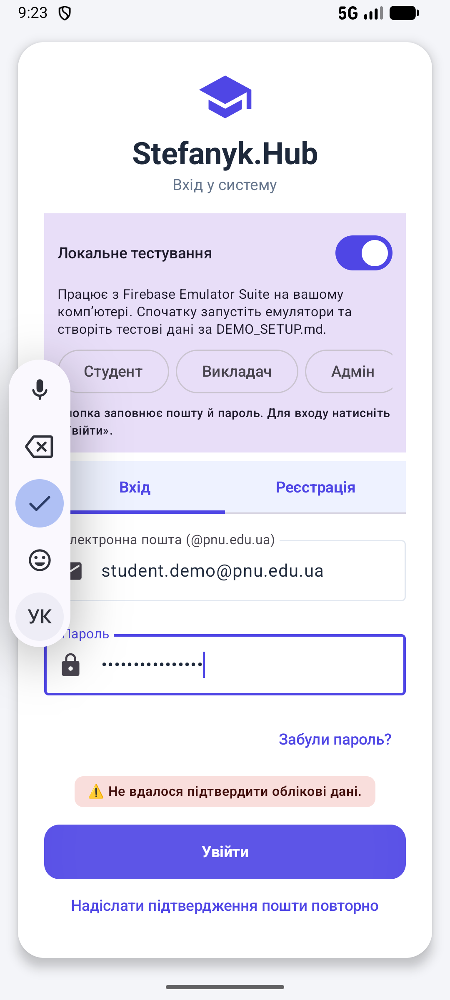
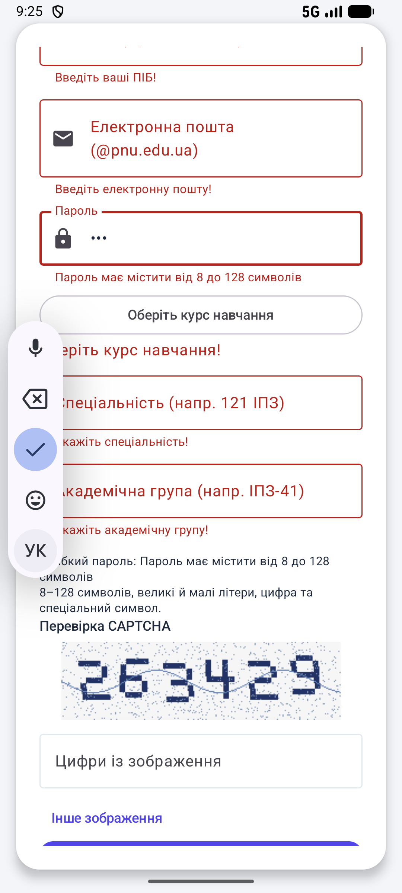
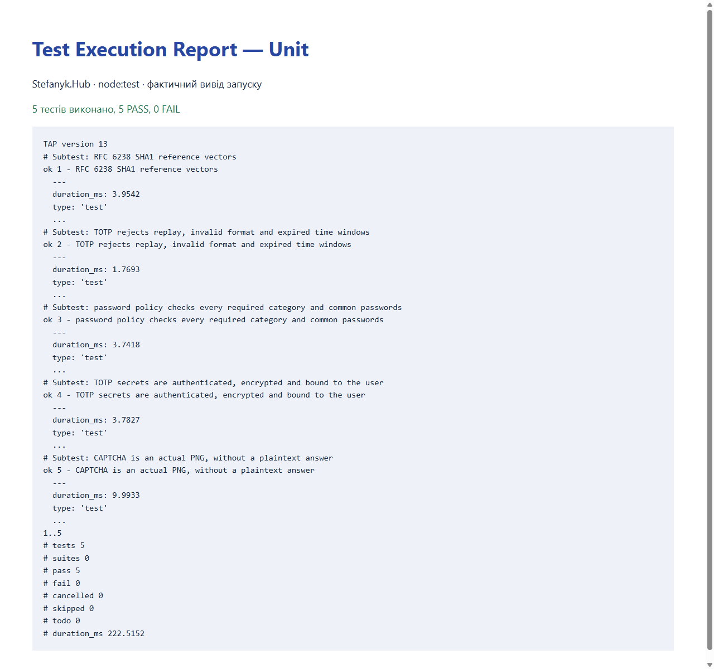
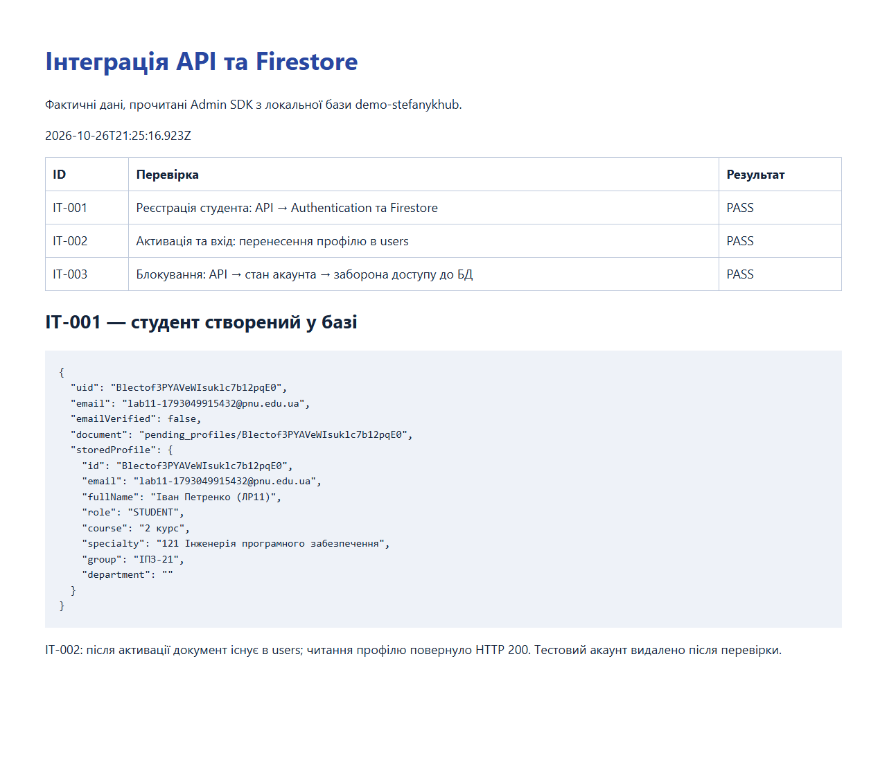
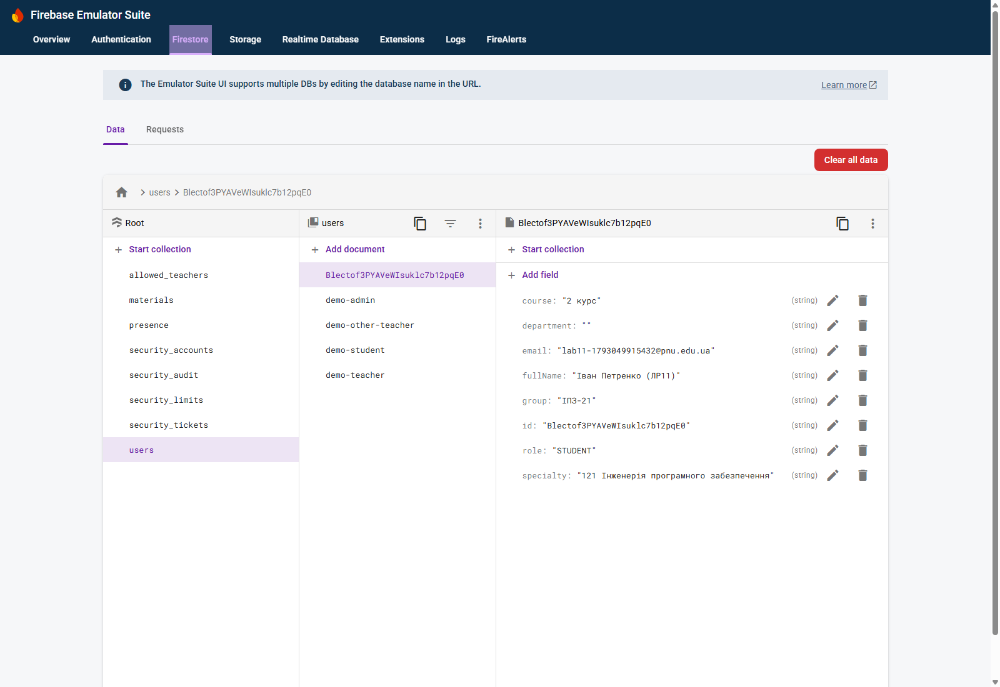

# ЛАБОРАТОРНА РОБОТА № 11

Тема: Тестування програмного забезпечення. Програмний продукт: мобільний застосунок «Stefanyk.Hub».

Виконала: ____________________    Група: ____________________

Мета: набути навичок розроблення тест-кейсів, виконання функціонального, модульного та інтеграційного тестування, фіксації результатів і опису дефектів.

## 1. Об’єкт і середовище тестування

Застосунок призначений для доступу до навчальних матеріалів. Тестування проведено на Android Emulator (Medium Phone, API 37 / Android 17), debug-збірка, локальний проєкт demo-stefanykhub. Використано Kotlin, JUnit4, Compose UI Test, Espresso 3.7.0, Node.js node:test та Firebase Emulator Suite. Мережеві відповіді у UI-тестах не підмінялися.

Адреси: API безпеки — localhost:8787; Authentication — 9099; Firestore — 8080; Storage — 9199. У базі один демо студент і два PDF. Додатковий студент створювався тимчасово для інтеграційних перевірок та видалявся після завершення.

Час інтеграційного запуску (UTC): 2026-10-26T21:25:16.923Z. Дата й час UI-запуску містяться в оригінальному JUnit XML у results/ui-final.xml.

| Функція | Об’єкт тестування | Тест-кейси |
|---|---|---|
| Реєстрація студента | Форма реєстрації, API та профіль у БД | TC011; IT-001 |
| Авторизація | Форма входу, API | TC001; TC007 |
| Перевірка обов’язкових полів та домену | Поля пошти й пароля | TC008–TC011 |
| Пошук | Поле пошуку каталогу | TC002; TC012 |
| Фільтрація | Панель курсів і скидання фільтрів | TC003 |
| Читання матеріалу | Картка та PDF-ридер | TC004 |
| Навчальна статистика | Панель прогресу | TC005 |
| Вихід | Кнопка виходу | TC006 |
| Активація і доступ до профілю | API, Authentication, Firestore | IT-002 |
| Блокування акаунта | Адміністративний API та правила БД | IT-003 |

Межі: під «звітністю» перевірено відображення навчальної статистики 100% (2/2). Експорт звіту в PDF/Excel у застосунку не реалізований і не позначається як перевірений. Справжня SMTP-доставка, Google OAuth, навантаження та фізичні пристрої не входили до цього запуску.

## 2. Функціональне тестування

Розроблено 12 сценаріїв: 6 позитивних і 6 негативних. Негативний тест має статус PASS, якщо система правильно відхилила некоректні дані. Кожен сценарій виконується в реальному інтерфейсі через JUnit/Compose UI Test.

### TC001 — Правильна авторизація

Тип: Позитивний. Передумови: Зареєстрований студент із підтвердженою поштою; 2FA вимкнена.

Вхідні дані: student.demo@pnu.edu.ua / DemoPass123!

Кроки: Відкрити вхід; натиснути «Студент»; натиснути «Увійти».

Очікуваний результат: Відкрито каталог із двома матеріалами та ім’ям Олена Тестова.

Фактичний результат: Відкрито каталог із двома матеріалами та ім’ям Олена Тестова. Статус: PASS.

### TC002 — Пошук наявного матеріалу

Тип: Позитивний. Передумови: Студент авторизований; у базі два матеріали.

Вхідні дані: SQL

Кроки: Відкрити пошук; ввести SQL.

Очікуваний результат: Показано один документ — «Бази даних: таблиці та SQL».

Фактичний результат: Показано один документ — «Бази даних: таблиці та SQL». Статус: PASS.

### TC003 — Фільтрація та скидання фільтрів

Тип: Позитивний. Передумови: Студент авторизований; обидва матеріали належать до 2 курсу.

Вхідні дані: Курс: 2 курс

Кроки: Відкрити фільтри; вимкнути 2 курс; натиснути системну «Назад»; перевірити 0 результатів; знову відкрити фільтри; натиснути «Скинути» та «Назад».

Очікуваний результат: Панель закривається без виходу із застосунку; після скидання знову видно 2 документи.

Фактичний результат: Панель закривається без виходу із застосунку; після скидання знову видно 2 документи. Статус: PASS.

### TC004 — Відкриття PDF з англійської

Тип: Позитивний. Передумови: Студент авторизований; Storage доступний; файл англійської не завантажений офлайн.

Вхідні дані: Англійська

Кроки: Знайти матеріал за словом «Англійська»; відкрити картку; натиснути «Читати матеріал»; дочекатися PDF.

Очікуваний результат: Ридер відображає «Сторінка 1 / 4» та зображення першої сторінки.

Фактичний результат: Ридер відображає «Сторінка 1 / 4» та зображення першої сторінки. Статус: PASS.

### TC005 — Відображення навчальної статистики

Тип: Позитивний. Передумови: У демо студента опрацьовані 2 матеріали з 2.

Вхідні дані: 2 опрацьовані / 2 доступні

Кроки: Увійти; переглянути блок «Прогрес навчання».

Очікуваний результат: Відображено «Загальний прогрес» та 100% (2/2).

Фактичний результат: Відображено «Загальний прогрес» та 100% (2/2). Статус: PASS.

### TC006 — Вихід із системи

Тип: Позитивний. Передумови: Студент авторизований.

Вхідні дані: Кнопка виходу

Кроки: Натиснути «Вийти з акаунту» у заголовку каталогу.

Очікуваний результат: Показано форму входу; каталог більше не відображається.

Фактичний результат: Показано форму входу; каталог більше не відображається. Статус: PASS.

### TC007 — Неправильний пароль

Тип: Негативний. Передумови: Акаунт студента існує; ліміт спроб не вичерпаний.

Вхідні дані: student.demo@pnu.edu.ua / WrongPassword42!

Кроки: Заповнити дані студента; замінити пароль на неправильний; натиснути «Увійти».

Очікуваний результат: Показано повідомлення «Не вдалося підтвердити облікові дані»; каталог не відкривається.

Фактичний результат: Показано повідомлення «Не вдалося підтвердити облікові дані»; каталог не відкривається. Статус: PASS.

### TC008 — Порожня електронна пошта

Тип: Негативний. Передумови: Відкрита форма входу.

Вхідні дані: Пошта порожня; пароль DemoPass123!

Кроки: Залишити пошту порожньою; ввести пароль; натиснути «Увійти».

Очікуваний результат: Показано «Введіть електронну пошту!».

Фактичний результат: Показано «Введіть електронну пошту!». Статус: PASS.

### TC009 — Порожній пароль

Тип: Негативний. Передумови: Відкрита форма входу.

Вхідні дані: student.demo@pnu.edu.ua; пароль порожній

Кроки: Ввести пошту; залишити пароль порожнім; натиснути «Увійти».

Очікуваний результат: Показано «Введіть пароль!».

Фактичний результат: Показано «Введіть пароль!». Статус: PASS.

### TC010 — Пошта стороннього домену

Тип: Негативний. Передумови: Відкрита форма входу.

Вхідні дані: student@gmail.com / DemoPass123!

Кроки: Ввести пошту Gmail та пароль; натиснути «Увійти».

Очікуваний результат: Показано вимогу використовувати @pnu.edu.ua або @stefanyk.edu.ua.

Фактичний результат: Показано вимогу використовувати @pnu.edu.ua або @stefanyk.edu.ua. Статус: PASS.

### TC011 — Слабкий пароль реєстрації

Тип: Негативний. Передумови: Відкрита вкладка «Реєстрація».

Вхідні дані: Пароль abc; решта полів не заповнена

Кроки: Ввести abc в поле пароля; натиснути «Зареєструватися»; перевірити помилку пароля.

Очікуваний результат: Показано вимогу 8–128 символів; повідомлення «Акаунт створено» відсутнє. Перевірка стосується виявлення слабкого пароля в незаповненій формі.

Фактичний результат: Показано вимогу 8–128 символів; повідомлення «Акаунт створено» відсутнє. Перевірка стосується виявлення слабкого пароля в незаповненій формі. Статус: PASS.

### TC012 — Пошук відсутнього матеріалу

Тип: Негативний. Передумови: Студент авторизований.

Вхідні дані: zzzz-no-such-material-98765

Кроки: Відкрити пошук; ввести запит, який не відповідає жодному матеріалу.

Очікуваний результат: Показано 0 документів; картки обох матеріалів відсутні.

Фактичний результат: Показано 0 документів; картки обох матеріалів відсутні. Статус: PASS.

### Таблиця фактичних результатів

| ID | Тест-кейс | Очікуваний результат | Фактичний результат | Статус |
|---|---|---|---|---|
| TC001 | Правильна авторизація | Відкрито каталог із двома матеріалами та ім’ям Олена Тестова. | Відкрито каталог із двома матеріалами та ім’ям Олена Тестова. | PASS |
| TC002 | Пошук наявного матеріалу | Показано один документ — «Бази даних: таблиці та SQL». | Показано один документ — «Бази даних: таблиці та SQL». | PASS |
| TC003 | Фільтрація та скидання фільтрів | Панель закривається без виходу із застосунку; після скидання знову видно 2 документи. | Панель закривається без виходу із застосунку; після скидання знову видно 2 документи. | PASS |
| TC004 | Відкриття PDF з англійської | Ридер відображає «Сторінка 1 / 4» та зображення першої сторінки. | Ридер відображає «Сторінка 1 / 4» та зображення першої сторінки. | PASS |
| TC005 | Відображення навчальної статистики | Відображено «Загальний прогрес» та 100% (2/2). | Відображено «Загальний прогрес» та 100% (2/2). | PASS |
| TC006 | Вихід із системи | Показано форму входу; каталог більше не відображається. | Показано форму входу; каталог більше не відображається. | PASS |
| TC007 | Неправильний пароль | Показано повідомлення «Не вдалося підтвердити облікові дані»; каталог не відкривається. | Показано повідомлення «Не вдалося підтвердити облікові дані»; каталог не відкривається. | PASS |
| TC008 | Порожня електронна пошта | Показано «Введіть електронну пошту!». | Показано «Введіть електронну пошту!». | PASS |
| TC009 | Порожній пароль | Показано «Введіть пароль!». | Показано «Введіть пароль!». | PASS |
| TC010 | Пошта стороннього домену | Показано вимогу використовувати @pnu.edu.ua або @stefanyk.edu.ua. | Показано вимогу використовувати @pnu.edu.ua або @stefanyk.edu.ua. | PASS |
| TC011 | Слабкий пароль реєстрації | Показано вимогу 8–128 символів; повідомлення «Акаунт створено» відсутнє. Перевірка стосується виявлення слабкого пароля в незаповненій формі. | Показано вимогу 8–128 символів; повідомлення «Акаунт створено» відсутнє. Перевірка стосується виявлення слабкого пароля в незаповненій формі. | PASS |
| TC012 | Пошук відсутнього матеріалу | Показано 0 документів; картки обох матеріалів відсутні. | Показано 0 документів; картки обох матеріалів відсутні. | PASS |












## 3. Модульне тестування

Для перевірки серверного модуля crypto.mjs використано вбудований фреймворк node:test та assert. Модуль містить passwordError, totp, matchTotp, encrypt/decrypt і captchaPng. Виконано п’ять окремих Unit-тестів; кожен містить перевірки граничних або негативних випадків.

| ID | Що перевірено | Очікування і результат |
|---|---|---|
| UT-001 | TOTP за шістьма офіційними векторами RFC 6238 | Збіг кодів із еталонами — PASS |
| UT-002 | Повторний, прострочений TOTP і неправильний формат | Коди відхиляються — PASS |
| UT-003 | Межі довжини, категорії символів, поширені паролі | Слабкі відхиляються; допустимі приймаються — PASS |
| UT-004 | AES-GCM: правильний ключ, інший UID та інший ключ | Відновлення лише з правильними параметрами — PASS |
| UT-005 | PNG CAPTCHA та відсутність відкритої відповіді | PNG має очікувані розміри; текст відповіді відсутній — PASS |

```powershell
node --test --test-reporter=tap tools/demo/security/crypto.test.mjs
```

Фактичний результат: tests 5, pass 5, fail 0. Оригінальний протокол: results/unit-tests.tap. Код тестів: tools/demo/security/crypto.test.mjs.

### Приклад реалізації та коду Unit-тестів

```powershell
export function passwordError(password) {
  if (typeof password !== 'string' || password.length < 8 || password.length > 128) return 'Пароль має містити від 8 до 128 символів.';
  if (!/\p{Lu}/u.test(password) || !/\p{Ll}/u.test(password) || !/[0-9]/.test(password) || !/[^\p{L}\p{N}\s]/u.test(password)) return 'Додайте велику й малу літери, цифру та спеціальний символ.';
  if (['password1!', 'password123!', 'qwerty123!', 'admin123!', '12345678aa!'].includes(password.toLowerCase())) return 'Цей пароль надто поширений. Виберіть інший.';
  return null;
}
```

```powershell
test('password policy checks every required category and common passwords',()=>{
  for(const password of ['Ab1!abc','abcdefgh1!','ABCDEFGH1!','Abcdefgh!','Abcdefgh1','Abcdefg1 ','Password123!','A'.repeat(129)])assert.ok(passwordError(password));
  assert.equal(passwordError('Abcdef1!'),null);
  assert.equal(passwordError('СкладнийПароль42!'),null);
});
```



## 4. Інтеграційне тестування

Компоненти: REST API безпеки → Firebase Authentication → Cloud Firestore; для перевірки обмеження доступу також використано клієнтський Firestore REST-запит. Тестова CAPTCHA підготовлена довіреним Admin SDK як fixture; це не перевірка розпізнавання картинки людиною. У протоколі не зберігаються паролі, токени сесій або посилання активації.

### IT-001 — Реєстрація студента: API → Authentication та Firestore

Передумови: Сервери доступні; тестова пошта ще не зареєстрована.

Вхідні дані: ПІБ: Іван Петренко (ЛР11); група ІПЗ-21; унікальна університетська пошта.

Кроки: Надіслати /api/register із правильною CAPTCHA; прочитати Auth-запис і pending_profiles за UID.

Очікуваний результат: Створено неактивований Auth-акаунт і профіль із правильними ПІБ та групою.

Фактичний результат: {"uid": "Blectof3PYAVeWIsuklc7b12pqE0", "email": "lab11-1793049915432@pnu.edu.ua", "emailVerified": false, "document": "pending_profiles/Blectof3PYAVeWIsuklc7b12pqE0", "storedProfile": {"id": "Blectof3PYAVeWIsuklc7b12pqE0", "email": "lab11-1793049915432@pnu.edu.ua", "fullName": "Іван Петренко (ЛР11)", "role": "STUDENT", "course": "2 курс", "specialty": "121 Інженерія програмного забезпечення", "group": "ІПЗ-21", "department": ""}}. Статус: PASS

### IT-002 — Активація та вхід: перенесення профілю в users

Передумови: IT-001 завершено; тестовий лист доступний у локальній outbox.

Вхідні дані: Одноразовий токен із тестового листа.

Кроки: Активувати акаунт; увійти через API; прочитати users/{uid} і перевірити видалення pending_profiles.

Очікуваний результат: Пошта підтверджена; users містить профіль; його читання повертає HTTP 200.

Фактичний результат: {"uid": "Blectof3PYAVeWIsuklc7b12pqE0", "email": "lab11-1793049915432@pnu.edu.ua", "emailVerified": true, "document": "users/Blectof3PYAVeWIsuklc7b12pqE0", "pendingProfileExists": false, "profileReadStatus": 200, "storedProfile": {"id": "Blectof3PYAVeWIsuklc7b12pqE0", "email": "lab11-1793049915432@pnu.edu.ua", "fullName": "Іван Петренко (ЛР11)", "role": "STUDENT", "course": "2 курс", "specialty": "121 Інженерія програмного забезпечення", "group": "ІПЗ-21", "department": ""}}. Статус: PASS

### IT-003 — Блокування: API → стан акаунта → заборона доступу до БД

Передумови: Тестовий студент увійшов; адміністратор авторизований.

Вхідні дані: UID студента та blocked=true.

Кроки: Заблокувати студента; прочитати security_accounts та Auth; виконати запит до профілю зі старим токеном; розблокувати.

Очікуваний результат: Стан blocked=true, Auth disabled=true, версія збільшена, старому токену відмовлено HTTP 403; розблокування працює.

Фактичний результат: {"uid": "Blectof3PYAVeWIsuklc7b12pqE0", "blocked": true, "authDisabled": true, "oldSessionReadStatus": 403, "versionBefore": 1, "versionAfter": 2, "unblockedAfterTest": true}. Статус: PASS

```powershell
node tools/demo/lab11-integration.mjs
```





## 5. Виявлені дефекти та повторне тестування

| ID / тип | Кроки та фактична проблема | Очікувана поведінка | Рішення / стан |
|---|---|---|---|
| DEF-001 / тестова інфраструктура | Запуск Compose UI Test на API 37 з Espresso 3.5.1: NoSuchMethodException InputManager.getInstance. 12 тестів не змогли розпочати функціональні перевірки. | Тестовий рушій запускає сценарії на емуляторі. | Espresso оновлено до 3.7.0, AndroidX JUnit — до 1.3.0. Початковий XML збережено; повторний запуск можливий. |
| DEF-002 / інтерфейс, середня важливість | Увійти → відкрити фільтри → натиснути системну «Назад». Застосунок завершував Activity; тест TC003 отримав NoActivityResumedException. | Закрити панель фільтрів і залишитися в каталозі. | Додано BackHandler для відкритої панелі. Результат повторного TC003: PASS. |
| TEST-001 / код нових тестів | Пошук лише за SetText знаходив два поля: каталог і пошук прихованої панелі. Точне порівняння помилки входу не враховувало префікс ⚠️. | Тест однозначно знаходить потрібний елемент і повідомлення. | Уточнено селектор за contentDescription та пошук тексту за підрядком. Це помилки тестового коду, а не окремі дефекти продукту. |

Докази початкових збоїв збережено у results/ui-initial-infrastructure-failure.xml та results/ui-selector-initial-run.xml. Фінальний протокол — results/ui-final.xml. Наявність початкового FAIL не прихована: після змін виконано повторне тестування та весь набір функціональних сценаріїв.

Офіційне джерело оновлення тестових бібліотек: https://developer.android.com/jetpack/androidx/releases/test. Espresso 3.7.0 використовує getSystemService замість застарілого рефлексивного InputManager.getInstance.

## 6. Підсумкові результати

| Набір | Виконано | PASS | FAIL |
|---|---|---|---|
| Функціональні UI-сценарії | 12 | 12 | 0 |
| Модульні тести | 5 | 5 | 0 |
| Сценарії інтеграції ЛР11 | 3 | 3 | 0 |

Додатково виконано наявний регресійний набір: 53 перевірки API безпеки та 31 перевірка авторизації, Storage й реакцій. Це кількість перевірок у скриптах, а не додаткові окремі UI-тест-кейси; протоколи збережено в results/security-api.txt та results/firebase-access.txt.

## Висновок

Під час лабораторної роботи визначено функції «Stefanyk.Hub», розроблено й виконано 12 функціональних сценаріїв (6 позитивних та 6 негативних), 5 модульних тестів і 3 інтеграційні сценарії. У фінальному запуску функціональні результати: 12/12 PASS. Перевірено роботу входу, пошуку, фільтрів, PDF-ридера, статистики й валідації, а також взаємодію API з Firebase. Виявлено та виправлено дефект оброблення кнопки «Назад» у фільтрах і несумісність тестових бібліотек. Результати підтверджено протоколами та скриншотами. Отримані результати стосуються перевірених сценаріїв локальної debug-збірки й не доводять відсутності всіх можливих дефектів.

## Відтворення перевірок

```powershell
.\tools\demo\start.cmd
node --test tools/demo/security/crypto.test.mjs
node tools/demo/lab11-integration.mjs
.\gradlew.bat :app:connectedDebugAndroidTest -Pandroid.testInstrumentationRunnerArguments.class=com.example.stefanykhub.Lab11FunctionalTest
```

Якщо сервери вже працюють, повторно start.cmd не запускайте. Скрипт build-lab11-report.py формує DOCX, Markdown і HTML за збереженими протоколами, не підмінюючи фактичні статуси.
