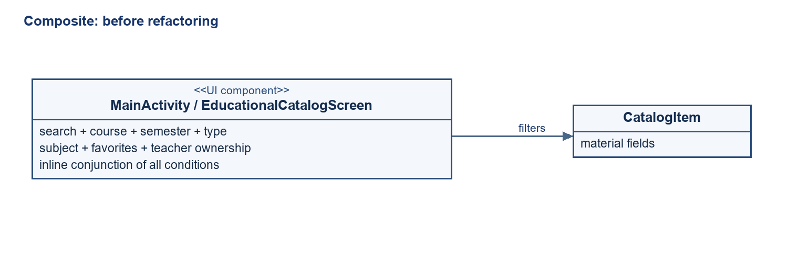
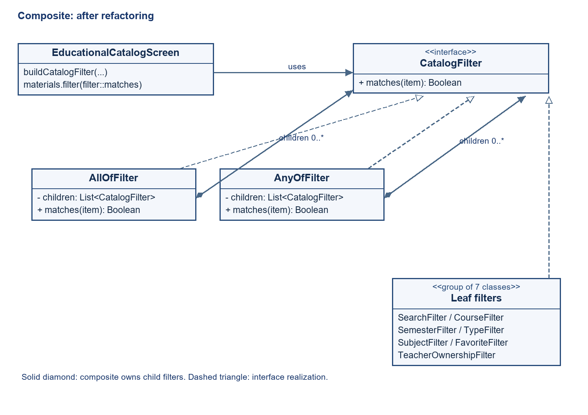
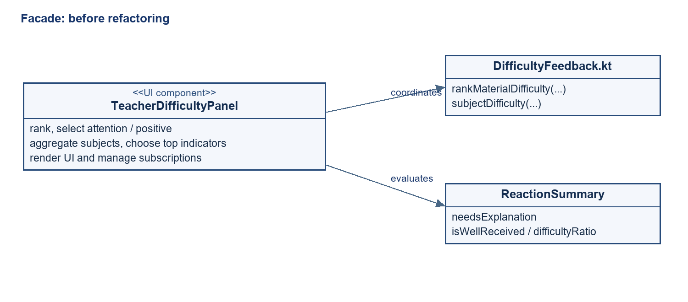
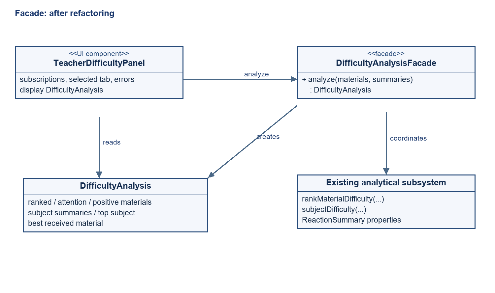

# Лабораторна робота №12

Тема: вдосконалення архітектури StefanykHub шляхом рефакторингу та впровадження патернів Composite і Facade.

Мета: відокремити правила фільтрації каталогу та координацію аналізу складності від компонентів інтерфейсу, зберігши поточну поведінку застосунку й перевіривши результат автоматизованими тестами.

Дата виконання: 31.10.2026. Проєкт: Android-застосунок StefanykHub, Kotlin, Jetpack Compose, Firebase. Робота виконана за умовою Lab 12.docx.

## 1. Аналіз і фіксація початкового стану

Застосунок містить каталог навчальних матеріалів із пошуком, фільтрами, обраним і пагінацією. Панель викладача показує реакції студентів, рейтинг складності й зведення за дисциплінами. Доступ до Firebase та реактивний стан зосереджені в AppRepository; моделі й чисті функції обчислень розташовані в model; інтерфейс побудований на Compose.

Створено окрему гілку lab12-composite-facade. Початковий коміт: d003bed56ab5cbd3492f58a285f2e67757949963. Початкові версії двох змінених UI-компонентів збережено в results/*.before.txt. Наявний локальний .idea/vcs.xml не змінювався.

До рефакторингу виконано 24 модульні тести: помилок 0. Протоколи JUnit збережено в results/baseline/. Базові сценарії обчислення реакцій, складності та навчальної статистики пройшли.

Запуск застосунку й ручні UI-сценарії до та після змін не перевірялися: adb devices не виявив підключеного пристрою або емулятора. Результат збірки APK та JVM-тести не прирівнюються до успішного запуску на Android.

## 2. Composite: композиція фільтрів каталогу

### 2.1. Початкова проблема й обґрунтування

У EducationalCatalogScreen файлу MainActivity.kt один блок materials.filter одночасно перевіряв пошук, курс, семестр, тип, дисципліну, обране та належність викладачу. Додавання умови вимагало редагувати UI-функцію; правила не мали незалежного інтерфейсу для повторного використання або вкладених комбінацій.

Composite обрано тому, що окрема умова й група умов виконують однакову операцію: визначають, чи підходить матеріал. Спільний CatalogFilter дозволяє вкладати AllOfFilter та AnyOfFilter один в одного. Це дерево об’єктів із єдиним інтерфейсом, а не лише винесена функція з тим самим набором if.



### 2.2. Нова структура та інтеграція

| Учасник | Роль |
|---|---|
| CatalogFilter | Component: matches(CatalogItem): Boolean. |
| SearchFilter, CourseFilter, SemesterFilter, TypeFilter, SubjectFilter, FavoriteFilter, TeacherOwnershipFilter | Leaf: окрема умова відбору. |
| AllOfFilter | Composite: усі дочірні умови повинні виконуватися (AND). |
| AnyOfFilter | Composite: достатньо однієї дочірньої умови (OR). |
| buildCatalogFilter() | Збирає дерево з поточних налаштувань; це допоміжна функція, не окреме впровадження патерна Builder. |
| EducationalCatalogScreen | Client: будує фільтр і застосовує його до матеріалів. |



```kotlin
fun interface CatalogFilter {
    fun matches(item: CatalogItem): Boolean
}

class AllOfFilter(private val children: List<CatalogFilter>) : CatalogFilter {
    override fun matches(item: CatalogItem) = children.all { it.matches(item) }
}

class AnyOfFilter(private val children: List<CatalogFilter>) : CatalogFilter {
    override fun matches(item: CatalogItem) = children.any { it.matches(item) }
}
```

Корінь дерева — AllOfFilter. Усередині нього SearchFilter та три AnyOfFilter для вибраних курсів, семестрів і типів. SubjectFilter, FavoriteFilter та TeacherOwnershipFilter додаються лише коли потрібні. Приклад реального відбору: пошук SQL AND (2 курс OR 3 курс) AND (3 семестр OR 4 семестр) AND Лабораторні AND Обране.

```kotlin
val catalogFilter = buildCatalogFilter(
    searchQuery = query,
    selectedCourses = selectedCourses,
    selectedSemesters = selectedSemesters,
    selectedTypes = selectedTypes,
    selectedSubject = selectedSubject,
    favoritesOnly = isFavoriteFilterActive,
    teacherId = if (isTeacher) user.id else null
)
val filteredItems = materials.filter(catalogFilter::matches)
```

Збережено нечутливий до регістру пошук у шести полях та обрізання пробілів запиту. Залишено зіставлення Лекція → Лекції та Лабораторна → Лабораторні. Порожній AnyOfFilter відхиляє всі матеріали, тому зняття всіх значень категорії дає нуль результатів. Порожній AllOfFilter приймає всі матеріали. Вимкнені необов’язкові обмеження не додаються до дерева. Порядок матеріалів і пагінація збережені; серверні правила доступу не змінювалися.

### 2.3. Переваги та недоліки

Переваги: UI не реалізує самі предикати; фільтри можна тестувати й повторно комбінувати; лист і група взаємозамінні; складні вкладені умови не потребують змін у механізмі обходу дерева. Недоліки: більше невеликих класів і об’єктів; дерево складніше за короткий одноразовий предикат; для нової категорії треба також оновити побудову дерева та стан інтерфейсу. Патерн не гарантує прискорення фільтрації.

## 3. Facade: єдина точка входу до аналізу складності

### 3.1. Початкова проблема й обґрунтування

TeacherDifficultyPanel безпосередньо викликав rankMaterialDifficulty та subjectDifficulty, відбирав матеріали з needsExplanation та isWellReceived, знаходив дисципліну з найбільшим difficultyRatio й матеріал із найбільшою кількістю позитивних реакцій. UI знав послідовність підготовки аналітики. Інший клієнт мав би повторити цю координацію.



Facade надає один метод analyze(materials, summaries), за яким прихована координація наявних операцій. Чисті функції підсистеми залишаються доступними; фасад спрощує типовий сценарій їх спільного використання. Створювати штучні класи для кожного обчислення не потрібно.

### 3.2. Нова структура та інтеграція

| Компонент | Відповідальність |
|---|---|
| DifficultyAnalysisFacade | Будує рейтинг, списки уваги й позитивних реакцій, підсумки дисциплін та обирає підсумкові показники. |
| DifficultyAnalysis | Містить rankedMaterials, attentionMaterials, positiveMaterials, subjectSummaries, mostDifficultSubject, bestReceivedMaterial. |
| SubjectDifficulty | Типізовано поєднує назву дисципліни з ReactionSummary. |
| rankMaterialDifficulty / subjectDifficulty / ReactionSummary | Наявна підсистема обчислень; алгоритми й пороги залишені без змін. |
| TeacherDifficultyPanel | Передає актуальний знімок реакцій, відображає результат, керує підписками, помилками, вкладками й діалогом. |



```kotlin
val facade = remember { DifficultyAnalysisFacade() }
val analysis = facade.analyze(owned, AppRepository.materialReactions.toMap())
val reports = analysis.rankedMaterials
val alerts = analysis.attentionMaterials
val positive = analysis.positiveMaterials
```

Фасад не залежить від Android, Compose або Firebase. Він аналізує лише передану вибірку матеріалів. Відбір власних матеріалів викладача та керування підписками залишені у панелі. remember зберігає лише екземпляр фасаду; результат перераховується з актуального стану, тому нові реакції не приховуються кешованою аналітикою.

Збережено пороги: сигнал уваги — щонайменше 3 проблемні реакції та їх частка понад 50%; позитивний сигнал — щонайменше 3 позитивні реакції та їх частка понад 50%. Рейтинг спочатку враховує потребу в поясненні, потім частку складності, кількість проблемних реакцій, загальну кількість реакцій та id. Підсумок дисципліни обчислюється сумуванням голосів, а не середнім відсотків матеріалів.

Відсутній запис у summaries означає, що дані ще не отримані: такий матеріал не потрапляє до рейтингу. Наявний порожній ReactionSummary є завантаженим результатом без голосів і залишається у рейтингу. Для порожніх підсумків mostDifficultSubject та bestReceivedMaterial дорівнюють null. Попередні правила вибору при рівності показників збережено.

### 3.3. Переваги та недоліки

Переваги: одна точка входу для клієнтів аналітики; менше координації у Compose; можливість повторного використання підготовки результатів та звичайного JVM-тестування. Недоліки: додано модель результату та шар виклику; фасад залежить від складу підсумкової аналітики. Його слід обмежувати аналізом складності, не перетворюючи на універсальний сервіс. У цій невеликій підсистемі головна користь — відокремлення відповідальностей, а не скорочення кількості операцій.

## 4. Змінені та додані файли

| Файл відносно app/src/ | Зміна |
|---|---|
| main/java/com/example/stefanykhub/model/catalog/CatalogFilter.kt | Інтерфейс та дві рекурсивні композиції. |
| main/java/com/example/stefanykhub/model/catalog/CatalogFilters.kt | Сім листових фільтрів. |
| main/java/com/example/stefanykhub/model/catalog/CatalogFilterBuilder.kt | Побудова дерева для поточного каталогу. |
| main/java/com/example/stefanykhub/MainActivity.kt | Заміна inline-перевірок на CatalogFilter. |
| main/java/com/example/stefanykhub/model/DifficultyAnalysis.kt | Моделі результату аналітики. |
| main/java/com/example/stefanykhub/model/DifficultyAnalysisFacade.kt | Координація підготовки аналітики. |
| main/java/com/example/stefanykhub/ui/components/TeacherDifficultyPanel.kt | Використання фасаду. |
| test/java/com/example/stefanykhub/CatalogFilterTest.kt | 10 нових тестів. |
| test/java/com/example/stefanykhub/DifficultyAnalysisFacadeTest.kt | 8 нових тестів. |

DifficultyFeedbackTest.kt не змінено: 9 його перевірок залишаються регресійною основою алгоритмів складності. Нові файли Kotlin написані без коментарів. Залежності проєкту й AppRepository для цих патернів не змінювалися.

## 5. Результати тестування

| Набір | До змін | Після змін | Помилки після |
|---|---|---|---|
| CatalogFilterTest | — | 10 | 0 |
| DifficultyAnalysisFacadeTest | — | 8 | 0 |
| DifficultyFeedbackTest | 9 | 9 | 0 |
| ExampleUnitTest | 1 | 1 | 0 |
| MaterialReactionTest | 5 | 5 | 0 |
| StudyStatisticsTest | 9 | 9 | 0 |
| Разом | 24 | 42 | 0 |

CatalogFilterTest перевіряє AND, OR, вкладені композиції, порожні групи, пошук у шести полях, назви типів, поєднання обмежень, порожні вибірки й вимкнені необов’язкові умови. Окремий регресійний тест порівнює результати зі старим предикатом на 2592 конфігураціях та п’яти матеріалах. Це один JUnit-тест із 2592 наборами налаштувань, а не 2592 окремі тести. Кінцева вибірка не доводить еквівалентність для всіх можливих даних.

DifficultyAnalysisFacadeTest перевіряє порожній результат; рейтинг і поділ матеріалів; зважену складність дисциплін; різницю між відсутніми та порожніми реакціями; ігнорування реакцій поза вибіркою; вибір позитивного матеріалу; повторний аналіз нового стану; збереження порядку за рівних показників.

Фінальний результат: 42 тести, помилок 0, пропущено 0. Команда :app:assembleDebug завершилася BUILD SUCCESSFUL. APK: app\build\outputs\apk\debug\app-debug.apk; розмір 24260378 байтів. Протоколи: results/final/TEST-*.xml; загальний підсумок і SHA-256 APK: results/summary.json.

Результати підтверджують перевірені правила фільтрації й аналітики та успішну компіляцію інтегрованих UI-компонентів. Інструментальні тести, ручна перевірка інтерфейсу та перевірка запуску на пристрої в межах цієї роботи не виконані.

## 6. Порівняння до та після

| Аспект | До | Після |
|---|---|---|
| Фільтрація | Набір перевірок усередині UI. | Дерево взаємозамінних фільтрів AND/OR. |
| Аналітика | Панель координує кілька операцій. | Один виклик фасаду повертає результат. |
| Тестування | Базові обчислення реакцій і статистики. | Додатково композиція умов і повний результат аналізу. |
| Правила предметної області | Пошук, відбір, пороги й зважені показники. | Збережені й перевірені регресійно. |
| Складність структури | Менше класів; більше відповідальностей UI. | Більше класів; чіткіший розподіл відповідальностей. |

## 7. Відтворення перевірок

```powershell
.\gradlew.bat :app:testDebugUnitTest :app:assembleDebug --console=plain
python tools/demo/build-lab12-report.py
```

Для Gradle потрібні встановлені JDK і Android SDK. Скрипт звіту використовує python-docx і Pillow; у цьому середовищі вони доступні в tools/demo/.python. Звіт відтворюється зі збережених протоколів лабораторної, а не підміняє їх новими статусами. Для фіксації нового запуску потрібно окремо оновити results/final/ і summary.json.

## Висновки

У StefanykHub впроваджено два структурні патерни на основі реальних передумов. Composite переніс правила каталогу з UI у дерево фільтрів зі спільним інтерфейсом. Facade відокремив координацію аналізу складності від панелі викладача, зберігши наявні функції та правила обчислення. Патерни інтегровані в робочі виклики екранів, а не додані як невикористані демонстраційні класи.

Після рефакторингу пройшли всі 42 модульні тести та debug-збірка. Порівняння фільтрації на 2592 конфігураціях не виявило відмінностей від початкової реалізації. Отримано можливість незалежно тестувати й повторно використовувати правила відбору та підготовку аналітики. Додаткові абстракції збільшили кількість класів, але зменшили відповідальність UI-компонентів. Перевірка запуску й UI на Android залишається окремим невиконаним етапом.
